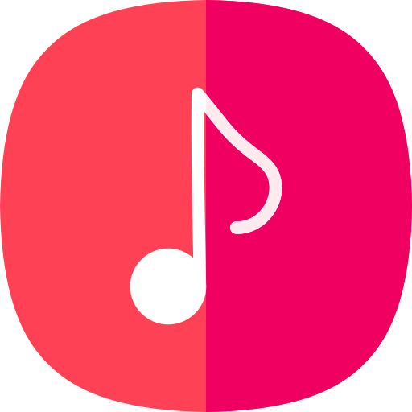
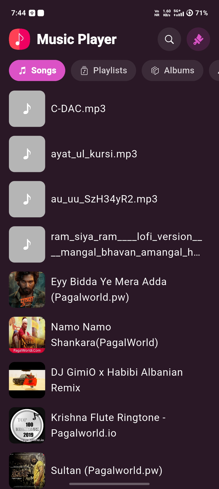
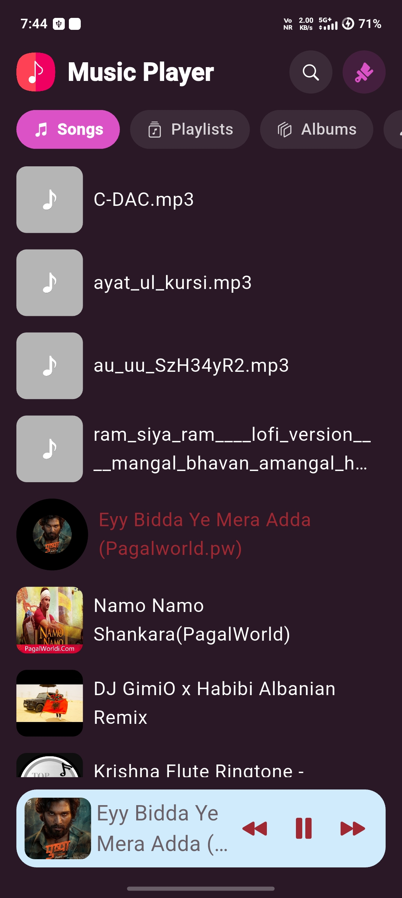
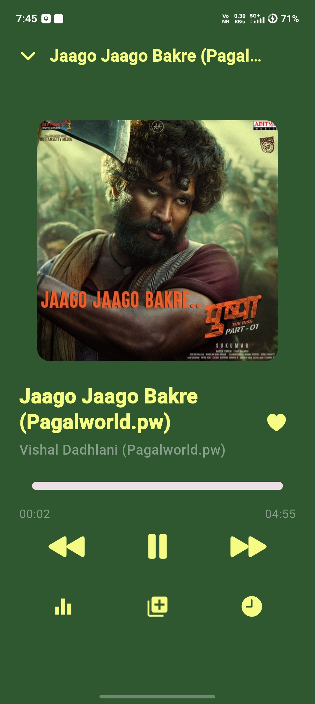
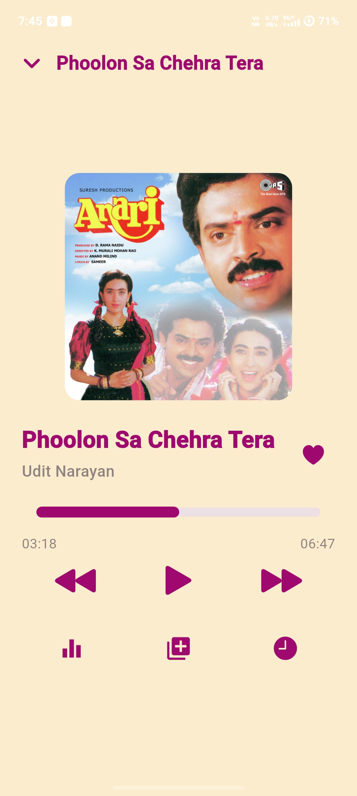
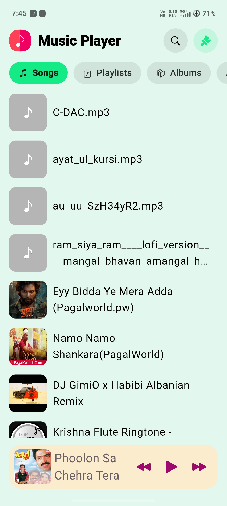
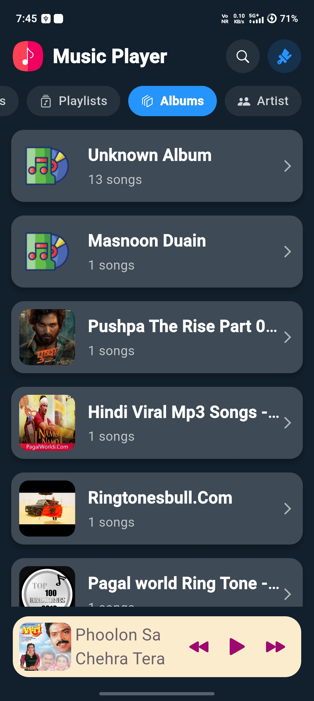
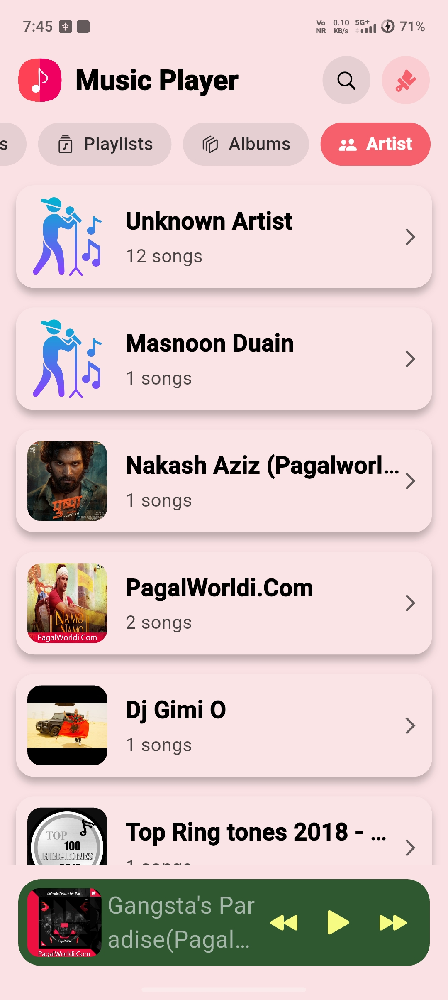

<div align="center">

  

  # 🎵 Music Player

  **A fast, elegant, and privacy-first offline audio player built with Flutter.**

  [](https://flutter.dev)
  [](https://developer.android.com)
  [](LICENSE)
  [](https://musicplayersahil.netlify.app/)
  [](https://musicplayersahil.netlify.app/)

  <p align="center">
    <a href="https://musicplayersahil.netlify.app/"><strong>🌐 Visit Official Website »</strong></a>
    <br />
    <a href="https://github.com/sahil-Parmar1/music_app.git">GitHub Repository</a>
    ·
    <a href="https://musicplayersahil.netlify.app/#video-demo">Watch Video Demo</a>
    ·
    <a href="https://musicplayersahil.netlify.app/#download">Download APK</a>
    ·
    <a href="https://musicplayersahil.netlify.app/privacy.html">Privacy Policy</a>
  </p>

</div>

---

## 📖 Overview

**Music Player** is a modern offline music application designed for pure audio playback without clutter, intrusive ads, or unnecessary permissions. It effortlessly indexes your local audio files, parses track metadata and album artwork, and delivers a seamless listening experience both inside the app and in the background.

With full support for **lock screen media controls**, **notification player**, **sleep timer**, and **smart library categorization**, Music Player provides everything you need in an Android music app while ensuring your data stays 100% private on your device.

---

## ✨ Key Features

- 🎧 **Offline Audio Playback:** High-performance playback engine for local audio formats (`.mp3`, `.m4a`, `.wav`, `.aac`, `.flac`).
- 🔔 **Lock Screen & Notification Player:** Seamlessly control playback (Play, Pause, Skip Next, Previous, and Track Info) directly from your notification drawer and lock screen without unlocking your device.
- 🌙 **Smart Sleep Timer:** Fall asleep to your favorite music with customizable shutoff intervals (15, 30, 45, or 60 minutes).
- 📂 **Smart Library Categorization:** Automatically scans and organizes your music library by **Songs**, **Artists**, and **Albums** with real-time search.
- 🎨 **Modern Dark UI:** Sleek, battery-friendly dark theme with smooth transitions, dynamic artwork glows, and an intuitive MiniPlayer bar.
- ⚡ **Lightweight & Fast:** Instant song seek and low latency powered by `audio_service` and `audioplayers`.
- 🛡️ **100% Private & Ad-Free:** Operates completely offline. No tracking SDKs, no analytics, no account registration required.

---

## 📸 App Screenshots

<div align="center">

| Library & Search | Mini Player Bar | Full Player Screen |
| :---: | :---: | :---: |
|  |  |  |

| Sleep Timer Dialog | Artists & Albums | Album Track List |
| :---: | :---: | :---: |
|  |  |  |

| Lock Screen & Notification Player |
| :---: |
|  |

</div>

> 🎥 **Video Walkthrough:** You can watch a video demonstration in `assets/Screenrecording_20261016_195023.mp4` or interactively stream it on the [Official Website](https://musicplayersahil.netlify.app/#video-demo).

---

## 🔗 Official Links

- **GitHub Repository:** [https://github.com/sahil-Parmar1/music_app.git](https://github.com/sahil-Parmar1/music_app.git)
- **Live Website & Release Details:** [https://musicplayersahil.netlify.app/](https://musicplayersahil.netlify.app/)
- **Privacy Policy:** [https://musicplayersahil.netlify.app/privacy.html](https://musicplayersahil.netlify.app/privacy.html)

---

## 🛠️ Tech Stack & Architecture

Music Player is built following clean Flutter architecture principles:

- **Framework:** [Flutter](https://flutter.dev) (Dart SDK `^3.7.2`)
- **State Management:** [`provider`](https://pub.dev/packages/provider)
- **Audio Playback:** [`audioplayers`](https://pub.dev/packages/audioplayers)
- **Background Audio & Media Notification:** [`audio_service`](https://pub.dev/packages/audio_service)
- **Local Storage & Cache:** [`hive`](https://pub.dev/packages/hive) & [`hive_flutter`](https://pub.dev/packages/hive_flutter)
- **Settings Persistence:** [`shared_preferences`](https://pub.dev/packages/shared_preferences)
- **Audio Tag & Metadata Parsing:** [`id3`](https://pub.dev/packages/id3)
- **Permissions Management:** [`permission_handler`](https://pub.dev/packages/permission_handler)

---

## 📂 Project Structure

```text
music_app/
├── android/                 # Android native configurations & manifests
├── assets/                  # App icons, UI graphics, and screenshots
│   ├── music-player.png     # Application logo
│   ├── Screenrecording_*.mp4 # App demo video
│   └── Screenshot_*.jpg     # UI showcase screenshots
├── lib/                     # Flutter source code
│   ├── models/              # Audio & Playlist data models
│   ├── providers/           # Audio state & UI providers
│   ├── screens/             # UI views (Player, Library, Albums, Details)
│   ├── services/            # AudioService & background playback handlers
│   └── widgets/             # Reusable UI components (MiniPlayer, TrackTile)
├── pubspec.yaml             # Project dependencies & asset declarations
└── README.md                # Project documentation
```

---

## 🚀 Getting Started

Follow these steps to set up and run the project locally on your machine:

### Prerequisites

- [Flutter SDK](https://docs.flutter.dev/get-started/install) (version 3.7.0 or higher)
- [Android Studio](https://developer.android.com/studio) or VS Code with Flutter extension
- An Android device or emulator running Android 8.0 (API 26) or higher

### Installation

1. **Clone the repository:**
   ```bash
   git clone https://github.com/sahil-Parmar1/music_app.git
   ```

2. **Navigate to the project root:**
   ```bash
   cd music_app
   ```

3. **Install Flutter packages:**
   ```bash
   flutter pub get
   ```

4. **Run the app on a connected device/emulator:**
   ```bash
   flutter run
   ```

5. **Build a release APK:**
   ```bash
   flutter build apk --release
   ```
   The generated APK will be located at `build/app/outputs/flutter-apk/app-release.apk`.

---

## 🔒 Permissions & Privacy

Music Player strictly requires only the permissions essential for local offline playback:

| Permission | Android API | Purpose |
| :--- | :--- | :--- |
| `READ_MEDIA_AUDIO` | Android 13+ (API 33+) | Scans local device storage to list and load your audio files. |
| `READ_EXTERNAL_STORAGE` | Android 12 and below | Reads audio files stored on device storage. |
| `FOREGROUND_SERVICE` | All versions | Keeps audio playing continuously when the app is in the background. |
| `FOREGROUND_SERVICE_MEDIA_PLAYBACK` | Android 14+ (API 34+) | Declares media playback foreground service type. |
| `POST_NOTIFICATIONS` | Android 13+ (API 33+) | Displays lock screen and notification media controls. |

> 🛡️ **Zero Tracking:** The app does not connect to any servers, does not transmit usage analytics, and does not require an internet connection.

---

## 👨‍💻 Author & Support

- **Developer:** Sahil Parmar
- **Email:** [sahilparmarpalanpur@gmail.com](mailto:sahilparmarpalanpur@gmail.com)
- **GitHub:** [@sahil-Parmar1](https://github.com/sahil-Parmar1)
- **Website:** [https://musicplayersahil.netlify.app/](https://musicplayersahil.netlify.app/)

Feel free to open an issue or submit a pull request if you have ideas, feature requests, or improvements!

---

## 📄 License

This project is licensed under the MIT License - see the [LICENSE](LICENSE) file for details.
